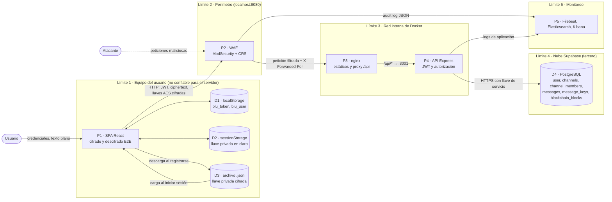

# Hito 1 · Diseño seguro y modelado de amenazas

**Proyecto final — Desarrollo Seguro, UVG, ciclo 2 2026**
**Aplicación:** Cifrados-Proyecto-2 (sustituye a OWASP Juice Shop, con aprobación del catedrático)
**Metodología:** PASTA, etapas 1 a 4, con STRIDE para clasificar las amenazas en la etapa 4

| Rol | Integrantes |
|---|---|
| Blue Team | Eunice Mata, Silvia Illescas |
| Red Team | Michelle Mejía, Esteban Zambrano |

---

## Resumen del proyecto

Cifrados es una aplicación web de mensajería grupal y directa con cifrado de extremo a extremo. El navegador cifra cada mensaje, la clave AES se cifra para cada destinatario y el servidor solo almacena texto cifrado. Cada mensaje se registra en una cadena de bloques encadenada por hash para detectar alteraciones.

---

## PASTA etapa 1 · Objetivos de negocio y de seguridad

### Objetivos de negocio

| ID | Objetivo de negocio | Por qué importa |
|---|---|---|
| ON-1 | Permitir que los usuarios escriban en grupos y en chats directos de forma privada | Es la propuesta de valor de la aplicación |
| ON-2 | Garantizar que ni el servidor ni la base de datos puedan leer los mensajes | Diferencia el producto y reduce el impacto de una filtración de la base de datos |
| ON-3 | Poder demostrar que el historial de mensajes no fue alterado | Confianza y auditoría |
| ON-4 | Mantener el servicio disponible para los usuarios legítimos | Una app de mensajería sin disponibilidad no se usa |
| ON-5 | Proteger los datos personales de los usuarios (nombre y correo) | Privacidad y reputación |

### Objetivos de seguridad derivados

| ID | Objetivo de seguridad | Propiedad | Objetivo de negocio |
|---|---|---|---|
| OS-1 | Solo los miembros de un canal pueden leer y escribir en él | Confidencialidad, autorización | ON-1 |
| OS-2 | Los mensajes y las llaves privadas nunca se almacenan en texto plano fuera del navegador del usuario | Confidencialidad | ON-2 |
| OS-3 | Cualquier modificación de un mensaje o de un bloque es detectable | Integridad | ON-3 |
| OS-4 | Solo usuarios autenticados acceden a la API y no pueden suplantar a otros | Autenticación | ON-1, ON-5 |
| OS-5 | La API resiste ráfagas, fuerza bruta y escaneos | Disponibilidad | ON-4 |
| OS-6 | Los ataques quedan registrados y se pueden detectar | No repudio, monitoreo | ON-3, ON-4 |
| OS-7 | La API no expone datos personales más allá de lo necesario | Confidencialidad, privacidad | ON-5 |

### Impacto si se compromete

| Escenario | Impacto |
|---|---|
| Un atacante lee mensajes de otros usuarios | Crítico, rompe ON-1 y ON-2 |
| Un atacante roba la sesión (JWT) o la llave privada de un usuario | Crítico, suplantación y lectura de todo su historial |
| Un atacante altera mensajes o la cadena sin ser detectado | Alto, rompe ON-3 |
| Se filtran los correos de todos los usuarios | Medio, privacidad, phishing dirigido |
| La API deja de responder | Medio, rompe ON-4; en este contexto académico no hay pérdidas económicas |

---

## PASTA etapa 2 · Alcance técnico

### Dentro y fuera del alcance

**Dentro del alcance:** el frontend (SPA), la API REST, el proxy nginx, el WAF, la base de datos Supabase del proyecto y el entorno local de Docker (entorno-blue-team/).

**Fuera del alcance:** la infraestructura interna de Supabase, el despliegue anterior en Render y GitHub. Por las reglas de enfrentamiento, solo se ataca el programa levantado en http://localhost:8080.

### Componentes y tecnologías

| Componentse | Tecnologías | Ubicación en el proyecto | Función |
|---|---|---|---|
| Frontend (SPA) | React 19, Vite 8, React Router 7 | `src/Pages`, `src/services`, `index.html` | Interfaz; genera llaves RSA, cifra y descifra mensajes |
| Criptografía en el cliente | Web Crypto API | `src/utils/crypto/*`, `src/utils/privateKeyEncryption.js` | AES-256-GCM, RSA-OAEP 2048 con SHA-256, firma digital, PBKDF2 para cifrar la llave privada |
| WAF | ModSecurity y OWASP CRS (imagen `owasp/modsecurity-crs:nginx-alpine`) | `entorno-blue-team/` | Único punto de entrada (`:8080`) |
| Proxy web | nginx 1.27 | `entorno-blue-team/web/nginx.conf` | Sirve el build y reenvía `/api/*` a la API |
| API REST | Node 22, Express 5, express-rate-limit 8 | `app.js` | Autenticación, autorización, persistencia |
| Autenticación | JWT HS256 de implementación propia, bcryptjs | `src/utils/jwt.js`, `src/auth/` | Emisión y verificación de sesiones |
| Blockchain | SHA-256, tabla `blockchain_blocks` | `src/blockchain/*` | Registro de mensajes a prueba de alteraciones |
| Base de datos | Supabase (PostgreSQL gestionado) | — | Tablas `user`, `channels`, `channel_members`, `messages`, `message_keys`, `blockchain_blocks` |
| SIEM | Filebeat, Elasticsearch y Kibana 8.15 | `entorno-blue-team/` | Recolección y análisis de logs para hito 3 |

### Puntos de entrada (todos con el prefijo `http://localhost:8080/api`)

| Método | Ruta | Autenticación | Control de acceso adicional | Rate limit |
|---|---|---|---|---|
| POST | `/auth/register` | No | Validación de nombre y correo con regex | 10 por hora por IP |
| POST | `/auth/login` | No | — | 10 intentos fallidos cada 15 min por IP |
| POST | `/groups` | JWT | — | No |
| GET | `/groups` | JWT | Solo los grupos del usuario | No |
| GET | `/groups/search?name=` | JWT | Ninguno (lista cualquier canal) | No |
| POST | `/groups/:id/join` | JWT | Código del grupo (se compara su SHA-256) | No |
| GET | `/groups/:groupId/messages` | JWT | Ser miembro del canal | No |
| GET | `/groups/:groupId/members/keys` | JWT | Ser miembro del canal | No |
| GET, POST | `/direct-conversations` | JWT | Solo los canales del usuario | No |
| POST | `/messages` | JWT | Ser miembro del canal | No |
| GET | `/messages/:userId` | JWT | `userId` debe ser igual al `sub` del token | No |
| GET | `/users` | JWT | Ninguno (lista a todos los usuarios) | No |
| GET | `/blockchain`, `/blockchain/verify` | JWT | — | No |
| POST | `/blockchain/tamper/:index`, `/blockchain/reset` | JWT | ID incluido en `BLOCKCHAIN_ADMIN_IDS` | No |

### Activos de información

| Activo | Dónde vive | Clasificación |
|---|---|---|
| Contenido de los mensajes | Solo en claro en el navegador, en la BD se ve en su forma ciphertext_base64 | Confidencial |
| Llave privada RSA | Archivo .json cifrado con PBKDF2 y AES-GCM en el equipo del usuario, en claro en sessionStorage (blu_private_key_pem) mientras dura la sesión | Secreto |
| Contraseña | En la BD como hash bcrypt | Secreto |
| JWT de sesión | localStorage (blu_token), válido 8 h | Secreto |
| JWT_SECRET y llave de Supabase de la API | Variables de entorno del contenedor api | Secreto |
| Código de invitación de grupo | channels.group_code y channels.key_hash | Confidencial |
| Correo, nombre y llave pública | Tabla `user` | Interno |
| Cadena de bloques | `blockchain_blocks` | Integridad crítica |
| Logs WAF y API | stdout de los contenedores, Elasticsearch | Interno, contienen correos e IDs |

### Controles existentes

- Contraseñas con bcrypt de 12 rondas y longitud mínima de 8 caracteres.
- JWT firmado con HMAC-SHA256 y comparado con `timingSafeEqual`; la API no arranca si el secreto tiene menos de 32 caracteres.
- Rate limit en login y registro.
- CORS con lista blanca (CLIENT_ORIGIN).
- Encabezados de seguridad: CSP, X-Frame-Options, nosniff, Referrer-Policy; x-powered-by deshabilitado.
- Los errores de base de datos se devuelven al cliente como un mensaje genérico (DB_ERROR_MESSAGE).
- Consultas a Supabase con el cliente oficial, que parametriza los valores (no hay SQL concatenado).
- Las pruebas Vitest de `src/tests/` cubren CORS, encabezados, JWT, divulgación de errores y autorización de la blockchain.
- Hallazgos previos de ZAP y Semgrep ya corregidos (docs/evidencias/).

---

## PASTA etapa 3 · Descomposición de la aplicación

### Diagrama de flujo de datos (DFD)

<!-- TODO: convertir esto en una imagen -->

### Límites de confianza

| ID | Límite | Qué lo cruza | Por qué es un límite |
|---|---|---|---|
| TB1 | Navegador del usuario ↔ servidor | Todas las peticiones HTTP | El servidor no controla el navegador: cualquier campo, encabezado o token puede venir manipulado |
| TB2 | Internet ↔ WAF | Todo el tráfico entrante | Primer punto de inspección, el WAF agrega la IP real del cliente |
| TB3 | WAF ↔ red interna (nginx, API) | Tráfico ya filtrado | La API confía en X-Forwarded-For (trust proxy = 1), así que solo debe ser alcanzable desde nginx |
| TB4 | API ↔ Supabase | Consultas con la llave de servicio | Tercero en la nube, si la API usa la llave de servicio (service role) se saltan las políticas RLS y toda la autorización depende del código de la API |
| TB5 | Usuario normal ↔ administrador de la blockchain | /blockchain/tamper y /blockchain/reset | Cambio de privilegio controlado por BLOCKCHAIN_ADMIN_IDS |
| — | Equipo del usuario ↔ archivo de llave privada | Descarga y carga del .json | La seguridad de la llave depende de la contraseña (PBKDF2) y del equipo del usuario |

### Flujos principales

1. **Registro:** la SPA genera un par RSA y cifra la llave privada con la contraseña (PBKDF2 + AES-GCM). Luego envía nombre, correo, contraseña y llave pública a POST /auth/register. La API guarda el hash bcrypt y la llave pública, y el navegador descarga el .json con la llave privada cifrada.
2. **Inicio de sesión:** POST /auth/login devuelve un JWT (8 h) que se guarda en localStorage. El usuario carga su .json y la llave privada descifrada queda en sessionStorage.
3. **Enviar mensaje:** la SPA pide GET /groups/:id/members/keys, cifra el mensaje una sola vez con AES-GCM, cifra la clave AES para cada miembro y envía POST /messages. La API verifica la membresía, guarda el mensaje y sus llaves cifradas, y lo registra en la blockchain.
4. **Leer mensajes:** GET /groups/:id/messages o GET /messages/:userId. El descifrado ocurre solo en el navegador.
5. **Unirse a un grupo:** se busca el grupo con GET /groups/search y se envía su código a POST /groups/:id/join.

---

## PASTA etapa 4 · Análisis de amenazas (STRIDE por componente)

**Escala.** Probabilidad (P) e Impacto (I): Alta (A), Media (M) o Baja (B). El riesgo resulta de combinar ambas. La columna "Estado" indica si la amenaza ya está mitigada o si es una hipótesis que el Red Team debe confirmar en el Hito 2.

### P1 - SPA y almacenamiento del navegador

| ID | STRIDE | Amenaza | Control existente | P | I | Riesgo | Estado |
|---|---|---|---|---|---|---|---|
| T-01 | I | Un XSS lee blu_token de localStorage y la llave privada en claro de sessionStorage | CSP script-src 'self', React escapa por defecto, regex en nombres | B | A | Media | Mitigada parcialmente, verificar todo el renderizado de datos de usuario |
| T-02 | S | Un token robado se puede usar durante 8 h y no hay forma de revocarlo (ni logout en el servidor) | Expiración exp | M | A | Alta | Hipótesis |
| T-03 | T | El cliente envía un sender_id u otros campos manipulados | La API toma sender_id de req.auth.sub e ignora el del cuerpo | B | M | Baja | Mitigada |
| T-04 | I | Si la contraseña es débil, el .json de la llave privada se puede atacar por fuerza bruta fuera de línea | PBKDF2, mínimo 8 caracteres | M | A | Media | Mitigada parcialmente |

### P2/P3 - WAF y nginx

| ID | STRIDE | Amenaza | Control existente | P | I | Riesgo | Estado |
|---|---|---|---|---|---|---|---|
| T-05 | S | Se falsifica X-Forwarded-For para evadir el rate limit por IP | nginx toma la IP real solo de proxies internos y reenvía un único valor | B | M | Baja | Mitigada; probar en el Hito 2 |
| T-06 | D | Ráfagas o escaneos saturan la API | Rate limit solo en login y registro; WAF en DetectionOnly | A | M | Alta | Hipótesis; se cubre en el Hito 3 |
| T-07 | E | Se evade el WAF con codificaciones o con una paranoia baja | CRS con paranoia 1 | M | M | Media | Se evalúa en el Hito 3 |
| T-08 | D | Falsos positivos del WAF bloquean mensajes legítimos (el texto cifrado en base64 puede parecer un payload) | Exclusiones planificadas | M | M | Media | Se evalúa en el Hito 3 |

### P4 - API autenticación

| ID | STRIDE | Amenaza | Control existente | P | I | Riesgo | Estado |
|---|---|---|---|---|---|---|---|
| T-09 | S | Fuerza bruta o credential stuffing en el login | 10 intentos fallidos cada 15 min por IP, sin bloqueo por cuenta | M | A | Media | Mitigada parcialmente, con muchas IPs se evade |
| T-10 | S | Falsificar un JWT (alg: none, otra firma, sub alterado) | HMAC-SHA256 fijo, timingSafeEqual, secreto de 32 caracteres o más | B | A | Media | Mitigada; probar en el Hito 2 |
| T-11 | I | Enumerar usuarios: el registro responde "Ese correo ya está registrado" y POST /direct-conversations responde "Contacto no encontrado" | Ninguno | A | B | Media | Hipótesis |
| T-12 | T | SQL o NoSQL injection en los campos del login o del registro | Cliente de Supabase parametrizado; regex de validación | B | A | Media | Mitigada; probar en el Hito 2 |

### P4 - API grupos, mensajes y usuarios

| ID | STRIDE | Amenaza | Control existente | P | I | Riesgo | Estado |
|---|---|---|---|---|---|---|---|
| T-13 | E | IDOR: leer mensajes o llaves de un canal ajeno cambiando :groupId | ensureChannelMember | B | A | Media | Mitigada; probar en el Hito 2 |
| T-14 | I | `GET /groups/search?name=direct` devuelve los canales directos (direct:<uuidA>:<uuidB>) y revela quién habla con quién; % y _ funcionan como comodines (name=% lista canales) | Ninguno; limitado a 20 resultados | A | M | Alta | Hipótesis fuerte |
| T-15 | I | GET /users devuelve nombre, correo y llave pública de todos los usuarios a cualquier usuario autenticado | Requiere JWT | A | M | Alta | Hipótesis fuerte |
| T-16 | E | Fuerza bruta del código de grupo en POST /groups/:id/join | Código de 8 caracteres (alfabeto de 31, unas 8.5·10¹¹ combinaciones); sin rate limit | B | A | Media | Mitigada por entropía; agregar rate limit |
| T-17 | I | channels.group_code se guarda en claro junto a key_hash, lo que anula el beneficio del hash si se filtra la tabla | Ninguno | B | M | Baja | Hipótesis |
| T-18 | T | POST /messages acepta encrypted_keys sin límite de cantidad ni validación de destinatario | Límite de 1 MB en el cuerpo | M | M | Media | Hipótesis |
| T-19 | D | Cuerpos de 1 MB repetidos o arreglos grandes consumen recursos | express.json({ limit: '1mb' }) | M | M | Media | Hipótesis |
| T-20 | I | Los errores revelan detalles internos | Mensaje genérico DB_ERROR_MESSAGE | B | M | Baja | Mitigada (prueba databaseErrorDisclosure.test.js) |

### Blockchain

| ID | STRIDE | Amenaza | Control existente | P | I | Riesgo | Estado |
|---|---|---|---|---|---|---|---|
| T-21 | E | Un usuario sin privilegios llama /blockchain/tamper o /blockchain/reset | requireBlockchainAdmin | B | A | Media | Mitigada (prueba blockchainDemoAuthorization.test.js) |
| T-22 | R | Si falla el registro en la blockchain, el mensaje se guarda igual y el error solo se imprime en consola | Ninguno | M | M | Media | Hipótesis |
| T-23 | T | Quien tenga acceso directo a la BD recalcula todos los hashes y la cadena sigue pareciendo válida (no hay anclaje externo) | Verificación de la cadena | B | A | Media | Riesgo aceptado (fuera del alcance) |

### D4 - Supabase y secretos

| ID | STRIDE | Amenaza | Control existente | P | I | Riesgo | Estado |
|---|---|---|---|---|---|---|---|
| T-24 | T | La tabla blockchain_blocks tiene RLS deshabilitado con la llave pública (anon/publishable) se pueden leer, insertar, modificar o borrar bloques directamente en Supabase, sin pasar por la API ni por requireBlockchainAdmin, y recalcular los hashes para que la cadena siga pareciendo válida | RLS activo en las demás tablas; /blockchain/verify detecta cambios aislados, pero no una cadena reescrita completa | M | A | Alta | Confirmado en la configuración de Supabase; pendiente PoC del Red Team |
| T-25 | I | Fuga de JWT_SECRET o de la llave de servicio por el repo o la imagen Docker | .gitignore y .dockerignore excluyen .env | B | A | Media | Mitigada; el pipeline del Hito 2 agrega búsqueda de secretos |

### P5 - Logs y monitoreo

| ID | STRIDE | Amenaza | Control existente | P | I | Riesgo | Estado |
|---|---|---|---|---|---|---|---|
| T-26 | R | Sin logs centralizados no se puede reconstruir un ataque | Logs de la API y del WAF hacia Elastic | M | M | Media | Se implementa en el Hito 3 |
| T-27 | I | Los logs contienen correos e IDs (datos personales) | Acceso local a Kibana con contraseña | B | B | Baja | Riesgo aceptado |

### Resumen por categoría

| STRIDE | Amenazas |
|---|---|
| Spoofing | T-02, T-05, T-09, T-10 |
| Tampering | T-03, T-12, T-18, T-23, T-24 |
| Repudiation | T-22, T-26 |
| Information disclosure | T-01, T-04, T-11, T-14, T-15, T-17, T-20, T-25, T-27 |
| Denial of service | T-06, T-08, T-19 |
| Elevation of privilege | T-07, T-13, T-16, T-21 |

---

## Requisitos de seguridad

Cada requisito se puede verificar (con una prueba, una PoC o una revisión) y se relaciona con una o más amenazas.

| ID | Requisito | Amenazas | Cómo se verifica |
|---|---|---|---|
| RS-01 | Todas las rutas, excepto /auth/register y /auth/login, deben rechazar con 401 las peticiones sin un JWT válido | T-10 | Prueba automatizada y PoC |
| RS-02 | La API debe responder 403 cuando un usuario accede a mensajes, llaves o miembros de un canal del que no es miembro | T-13 | CA-03 |
| RS-03 | Los JWT deben expirar en un tiempo máximo de 1h y debe existir un mecanismo de revocación o cierre de sesión en el servidor | T-02 | Revisión de código y prueba |
| RS-04 | Toda ruta autenticada debe tener un límite de peticiones por usuario o por IP; login y registro mantienen sus límites actuales | T-06, T-09, T-16, T-19 | CA-04, CA-08 |
| RS-05 | La búsqueda de grupos no debe devolver canales directos y debe escapar los comodines % y _ | T-14 | CA-07 |
| RS-06 | La API no debe exponer el correo de usuarios con los que no se comparte un canal | T-11, T-15 | PoC sobre GET /users |
| RS-07 | Todos los datos de usuario (nombres de grupo, nombres de usuario) se muestran escapados; la CSP no permite scripts en línea | T-01 | CA-02 y ZAP |
| RS-08 | Las entradas se validan por tipo, longitud y formato antes de llegar a la BD, y la BD solo recibe consultas parametrizadas | T-12, T-18 | CA-01 y SAST |
| RS-09 | Las operaciones administrativas de la blockchain solo se permiten a los IDs autorizados y quedan registradas | T-21 | CA-06 |
| RS-10 | Si un mensaje no se puede registrar en la blockchain, el evento debe registrarse como error auditable (o rechazarse el mensaje) | T-22 | Revisión de código |
| RS-11 | RLS debe estar habilitado en todas las tablas de Supabase y la llave pública no debe permitir leer user.password | T-24 | Consulta directa con la llave anon |
| RS-12 | Ningún secreto vive en el repositorio ni en las imágenes; el pipeline falla si detecta uno | T-25 | Escáner de secretos en CI (Hito 2) |
| RS-13 | El WAF registra todas las peticiones sospechosas y los logs llegan a Elastic con la IP real, la hora y el payload | T-05, T-26 | Hito 3 |
| RS-14 | Las contraseñas deben tener al menos 8 caracteres para proteger también la llave privada cifrada | T-04, T-09 | Prueba unitaria |

---

## Casos de abuso

### CA-01 · Inyección SQL en el inicio de sesión
- **Dado** un atacante sin cuenta frente a `http://localhost:8080`
- **Cuando** envía `POST /api/auth/login` con `{"email":"admin@x.com' OR '1'='1","password":"x"}`
- **Entonces** la API responde 401 sin sesión, sin error de base de datos ni detalles internos, y el WAF registra la petición con una regla 942xxx (SQLi); en modo On responde 403.
- Requisitos: RS-08, RS-13 · Amenaza: T-12

### CA-02 · XSS almacenado en el nombre de un grupo
- **Dado** un usuario autenticado
- **Cuando** crea un grupo llamado ``
- **Entonces** la API lo rechaza con 400 por la validación, ningún otro usuario ejecuta el script y el WAF registra la petición con una regla 941xxx (XSS).
- Requisitos: RS-07, RS-13 · Amenaza: T-01

### CA-03 · IDOR en los mensajes de un grupo ajeno
- **Dado** el usuario A, autenticado y que no es miembro del grupo G
- **Cuando** llama `GET /api/groups/<id-de-G>/messages` y `GET /api/groups/<id-de-G>/members/keys` con su propio JWT
- **Entonces** la API responde 403 "No perteneces a este chat" y no devuelve mensajes ni llaves.
- Requisitos: RS-02 · Amenaza: T-13

### CA-04 · Fuerza bruta en el inicio de sesión
- **Dado** un atacante que conoce el correo de una víctima
- **Cuando** envía 11 intentos de login fallidos en menos de 15 minutos desde la misma IP
- **Entonces** a partir del intento 11 la API responde 429, y el SIEM genera una alerta de ráfaga por IP.
- Requisitos: RS-04, RS-13 · Amenaza: T-09

### CA-05 · JWT manipulado
- **Dado** un usuario con un JWT válido
- **Cuando** cambia el `sub` del payload por el ID de otro usuario (o pone `alg: none` y quita la firma) y llama `GET /api/groups`
- **Entonces** la API responde 401 "JWT invalido."
- Requisitos: RS-01 · Amenaza: T-10

### CA-06 · Alterar la blockchain sin privilegios
- **Dado** un usuario autenticado cuyo ID no está en `BLOCKCHAIN_ADMIN_IDS`
- **Cuando** llama `POST /api/blockchain/tamper/1` o `POST /api/blockchain/reset`
- **Entonces** la API responde 403 y la cadena sigue siendo válida en `GET /api/blockchain/verify`.
- Requisitos: RS-09 · Amenaza: T-21

### CA-07 · Descubrir conversaciones privadas con la búsqueda de grupos
- **Dado** un usuario autenticado
- **Cuando** llama `GET /api/groups/search?name=direct` o `?name=%`
- **Entonces** la respuesta no incluye canales directos ni lista grupos con comodines.
- Requisitos: RS-05 · Amenaza: T-14
- *Se espera que hoy este caso **falle** (hipótesis T-14): es candidato a hallazgo del Red Team y a corrección en el Hito 4.*

### CA-08 · Escaneo automatizado
- **Dado** un atacante con una herramienta de escaneo (por ejemplo, ZAP o nikto) apuntando a `localhost:8080`
- **Cuando** envía más de 100 peticiones en 1 minuto, con muchos 404 y 403
- **Entonces** el SIEM genera una alerta de escaneo por IP y el WAF registra las firmas del escáner (reglas 913xxx).
- Requisitos: RS-04, RS-13 · Amenaza: T-06

---

## Uso de IA

Según la guía de la UVG: este documento se redactó con apoyo de Claude Opus 5.5 a partir del análisis del código del repositorio. El equipo revisó y validó cada amenaza contra el código fuente. 

<!-- TODO: completar con prompts  -->
